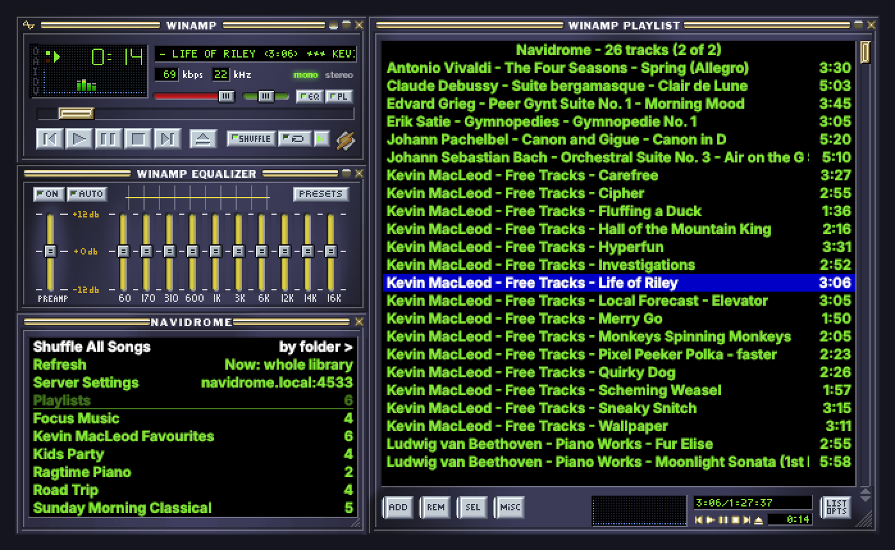
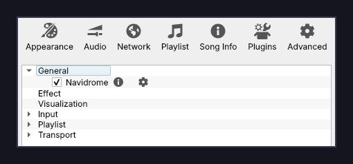
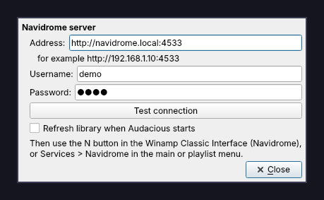
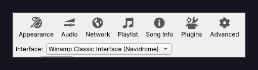
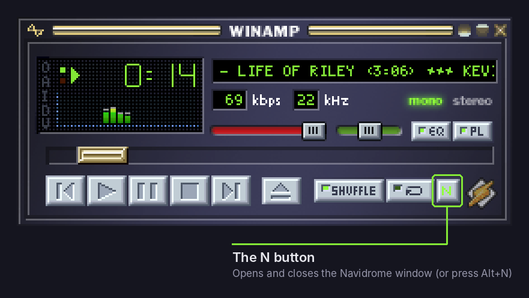
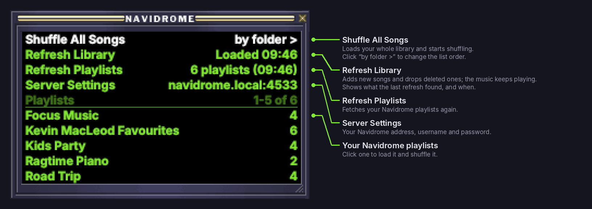

# navidamp

**Play your Navidrome library in Audacious, Winamp-style.**

Shuffle your whole Navidrome library, or any of your Navidrome playlists, from
Audacious's Winamp Classic interface. Your skin is used throughout: a new **N**
button sits next to Repeat, and a skinned Navidrome window docks under the
equaliser.



## Features

- **Shuffle everything:** one click loads your whole library and starts
  shuffling, Winamp-style. Every track plays once before anything repeats.
- **Your playlists:** every Navidrome playlist is listed in the window, and one
  click loads and shuffles it.
- **Refresh without stopping:** **Refresh Library** adds new albums and drops
  deleted tracks while the music keeps playing; **Refresh Playlists** fetches
  your playlist list again. Each says what its last run found and when, e.g.
  `+12 new, -3 removed (09:41)`.
- **Quick with big libraries:** your library is fetched four pages at a
  time, with a running count and percentage in the Navidrome window
  (`20,000 / 46,809 (42%)`).
- **Look a track up in Navidrome:** right-click a track and choose **Open in
  Navidrome** to open its album in Navidrome's web interface (or its artist,
  if it has no real album). Nothing is played.
- **Pick the list order:** by folder (like importing a local library), by
  artist, by title, or scrambled. Playback is shuffled whichever you pick.
- **Matches your skin:** the window uses your skin's frame, title lettering,
  playlist colours and font. The button is built from your skin's own buttons.
- **Reliable streaming:** tracks play with the right decoder straight away,
  short network hiccups are retried, and formats Audacious can't play out of
  the box are converted to MP3 by Navidrome as they play. So are MP3s that
  trip up Audacious's MP3 decoder (odd or oversized ID3 tags, junk before the
  audio, or files that aren't really MP3s).
- **Plays nicely:** the normal Winamp interface stays installed, and you can
  switch between them at any time.

## Requirements

- **Arch Linux** or an Arch-based distro (CachyOS, EndeavourOS, Manjaro...)
- **Audacious 4.6.x** with `audacious-plugins`
- **A Navidrome server.** Any server that speaks the Subsonic API should
  work, but only Navidrome is tested.

## Install

```sh
git clone https://github.com/a-adz-1/navidamp.git
cd navidamp
makepkg -si
```

The first build downloads the `audacious-plugins` source at the matching
release, because the interface is built from it. That takes a minute or two.
Restart Audacious when it's done.

To remove it: `sudo pacman -R navidamp`

## Setup

### 1. Turn on the Navidrome plugin

Open **Settings → Plugins → General** and tick **Navidrome**.



### 2. Enter your server

Click the plugin's settings icon (the cog next to it) and fill in:

- **Address:** your server, for example `http://192.168.1.10:4533`
- **Username** and **Password:** your Navidrome login

Click **Test connection** to check them. If **Refresh library when Audacious
starts** is ticked, new music is picked up every time you open Audacious.



You can get back here any time from **Server Settings** in the Navidrome window.

### 3. Switch to the Navidrome interface

Open **Settings → Appearance** and choose **Winamp Classic Interface
(Navidrome)**. It uses your current skin and window layout.



## Using it

Click **N** on the main window, or press **Alt+N**, to open the Navidrome
window. It's also under View → Show Navidrome.



The window snaps to the other Winamp windows. Drag its bottom-right corner to
make it taller, and scroll the playlists with the mouse wheel.



Everything plays from a playlist called **Navidrome**. It's reused each time
and leaves your other playlists alone. Right-click a track and choose **Open in
Navidrome** to see it in Navidrome's web interface: its album, or its
artist's page for tracks Navidrome files under "[Unknown Album]". (It's also
under Services → **Navidrome: Open Track in Navidrome**, which works in any
interface.) Audacious's own sort options (title,
artist, album, track number) work on it too.

Without the Navidrome interface, right-click the main window or the playlist
and look under **Services**. That menu has Play Library in each order and
Refresh Library, but not your Navidrome playlists.

navidamp doesn't watch your server for changes: after adding music to
Navidrome, click **Refresh Library** (or tick **Refresh library when Audacious
starts** in Server Settings).

## Custom button art

The **N** is drawn to match whatever skin is loaded. To use your own picture
instead, make a **14×60** pixel PNG with four 15-pixel rows, top to bottom:

1. closed
2. closed and pressed
3. open
4. open and pressed

Save it as either of these:

- `~/.config/audacious/navidrome-button.png`, which works with every skin
- `navidrome.png` or `navidrome.bmp` inside a skin

## After Audacious updates

- **Bug-fix releases** (4.6.1 → 4.6.2) need nothing.
- **Feature releases** (4.6 → 4.7) need a rebuild. Until then, Audacious falls
  back to the normal Winamp interface.
  1. In `PKGBUILD`, set `_audver` and `_audcommit` to the new release's tag and
     commit.
  2. Run `makepkg -si --force`.

  The interface patch may need updating for a big release; please open an
  issue if it doesn't apply.

## Troubleshooting

| Problem | Fix |
|---|---|
| No **N** button | Check Settings → Appearance → Interface is set to **Winamp Classic Interface (Navidrome)**. |
| Window says "Turn on Navidrome in Settings > Plugins" | Tick **Navidrome** under Settings → Plugins → General. |
| "Couldn't reach Navidrome" | Check the address in Server Settings, including `http://` and the port, and that the server is up. |
| "Wrong username or password" | Re-enter them in Server Settings. Passwords with symbols are fine. |
| Playlists don't appear | The window shows why under **Playlists**. Fix that, then click **Refresh Playlists**. |
| "By folder" groups tracks by artist, not by your real folders | Navidrome reports made-up `Artist/Album` paths by default. In Navidrome, open your profile menu → **Players**, pick **audacious-navidrome**, turn on **Report Real Path**, then click **Shuffle All Songs** again. |
| A track won't play | Run Audacious from a terminal: each failed attempt is logged with Navidrome's reason. |

## How it works

`navidamp` is three small Audacious plugins:

| Plugin | Built from | What it does |
|---|---|---|
| **Navidrome** (general) | `navidrome.cc` | Settings, menus, and talking to the server (Subsonic API, with a fresh login token for each request) |
| **Navidrome Streaming** (transport) | `navidrome.cc` | Plays `navidrome://raw/<id>.flac` style addresses, so Audacious picks the right decoder from the extension, with retries |
| **Winamp Classic Interface (Navidrome)** | `navidrome-interface.patch` | A copy of Audacious's Winamp interface with the N button and the Navidrome window added |

The interface asks the Navidrome plugin to do things; all the server work
happens in the plugin. The original Winamp interface is never modified.

Your password is stored in Audacious's config file
(`~/.config/audacious/config`), like any other plugin setting.

## Credits and licence

- navidamp is licensed under the **GNU GPL, version 3**, the same licence as
  the Winamp Classic interface it builds on (© the Audacious developers).
- The screenshots show the Winamp Classic CM skin with a demo library of
  public-domain classical pieces and Kevin MacLeod's royalty-free tracks
  ([incompetech.com](https://incompetech.com), CC BY 4.0). No music is
  included in this repo.
- Not affiliated with Navidrome, Audacious or Winamp.

See [LICENSE](LICENSE). Made by [a-adz-1](https://github.com/a-adz-1).
